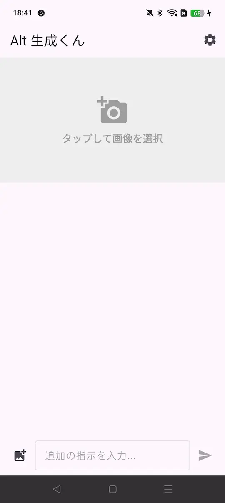
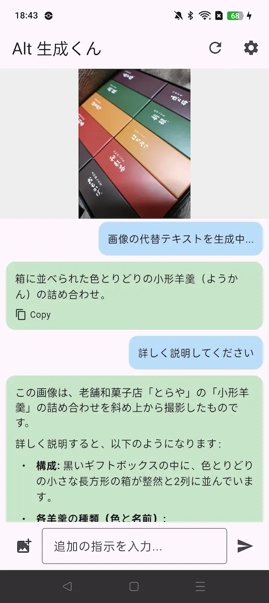

# Alt 生成くん (Alt Assistant App)

Gemini AIを活用して、画像の代替テキスト（Alt Text）を瞬時に生成し、AIと対話できる Android 専用アプリです。

## 概要

「Alt 生成くん」は、視覚情報を言語化する作業をAIの力で効率化します。画像をライブラリから選択またはカメラで撮影するだけで、アクセシビリティに配慮した説明文を生成します。

## スクリーンショット

| 初期画面 | 生成結果画面 |
| :---: | :---: |
|  |  |

## ダウンロード (Android)

Android 版は以下の Releases ページから最新の APK ファイルをダウンロードしてインストールできます（リリース APK は `arm64-v8a` 対応 Android 端末専用です）。

[最新のAPKをダウンロード](https://github.com/shodoi/alt-assistant-app/releases)

## 主要機能

- **AIによる代替テキスト生成**: Google の Gemini AI が画像を解析し、自然な日本語で説明文を作成します。
- **単一最新モデル対応**: 最新の `gemini-4-hydrogen` モデルを採用し、シンプルで安定した代替テキスト生成・チャット体験を提供します。
- **AIチャット機能**: 生成されたテキストに対して、「もっと短くして」「SNSの投稿文にして」など、チャット形式で追加の指示や最新応答の再生成を行えます。
- **選択可能テキストとワンタップコピー**: チャット本文は選択可能テキスト（`SelectableText`）で表示され、部分選択・コピーと Copy ボタンの両方を利用できます。
- **カメラ・ライブラリ対応**: Android の標準画像ピッカーとカメラ撮影に対応し、選択画像の全画面プレビューも行えます。
- **セキュアな設定**: Gemini API キーやカスタム初期プロンプトは端末内の暗号化ストレージ（`flutter_secure_storage` / Android Keystore）に保存されます。

## 特徴

- **Android 専用・軽量設計**: Android（リリースビルドは `arm64-v8a` 単一 ABI）に特化し、R8 によるコード・リソース縮小と Dart デバッグシンボル分離・難読化により APK サイズを抑えています。
- **モダンなUI/UX**:
  - 直感的な画像選択（中央エリアのタップからボトムシートで選択）
  - 生成状況のリアルタイム表示
  - 30秒のタイムアウト管理による安定した動作
  - システムナビゲーションバーを考慮した SafeArea 設計

## セットアップ

### 必要条件
- [Flutter SDK](https://docs.flutter.dev/get-started/install)
- Android SDK / Android 実機またはエミュレータ
- [Gemini API Key](https://aistudio.google.com/app/apikey)

### インストール
1. リポジトリをクローンします。
   ```bash
   git clone https://github.com/shodoi/alt-assistant-app.git
   ```
2. 依存関係をインストールします。
   ```bash
   flutter pub get
   ```
3. Android デバイスでアプリを起動します。
   ```bash
   flutter run
   ```

## 技術スタック
- **Framework**: Flutter (Dart) — Android 専用
- **AI**: Google Generative AI (`google_generative_ai` / Gemini API)
- **Storage**: `flutter_secure_storage`
- **Media**: `image_picker`

## ビルドコマンドガイド (Android)

- **デバイス確認**
  ```bash
  flutter devices
  ```
  実行結果の例:
  `A401OP (mobile) • VSVWGMWOQKPJNZFA • android-arm64 ...`
  - 左側 (`A401OP`): **デバイス名**
  - 中央 (`VSVWGMWOQKPJNZFA`): **Device ID** (一意の識別子)

- **検証 (Debug)**
  デバイス名または Device ID を指定して実行します（Debug ビルドは ABI 制限を受けないためエミュレータ等でも検証できます）。
  ```bash
  flutter run -d <Device ID>
  # 例 (ID指定・推奨): flutter run -d VSVWGMWOQKPJNZFA
  # 例 (名前指定):    flutter run -d A401OP
  ```

- **本番 (Release — `arm64-v8a` 専用)**
  R8 によるコード・リソース縮小、Dart のデバッグシンボル分離、および難読化を有効にして `arm64-v8a` 専用 APK をビルドします。
  ```bash
  flutter build apk --release --split-debug-info=build/app/outputs/symbols --obfuscate
  # APK 出力先: build/app/outputs/flutter-apk/app-release.apk (arm64-v8a 専用)
  # デバッグシンボル出力先: build/app/outputs/symbols (Git 管理対象外)
  # インストール: flutter install -d <Device ID>
  ```

---
Created with ❤️ by shodoi
